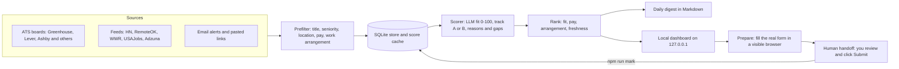
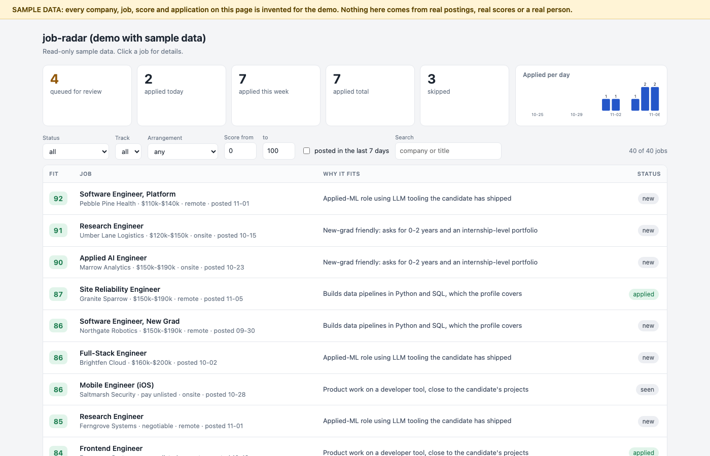
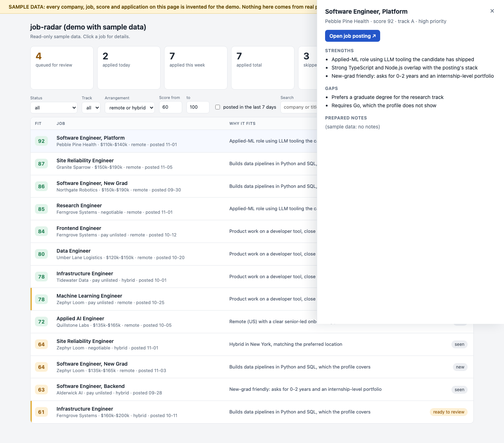
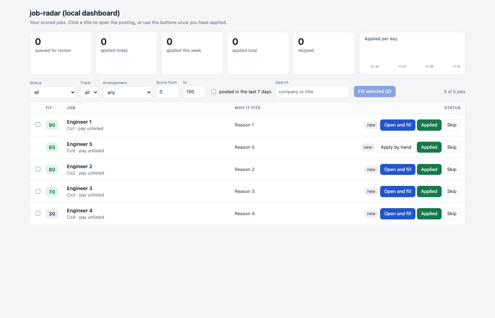
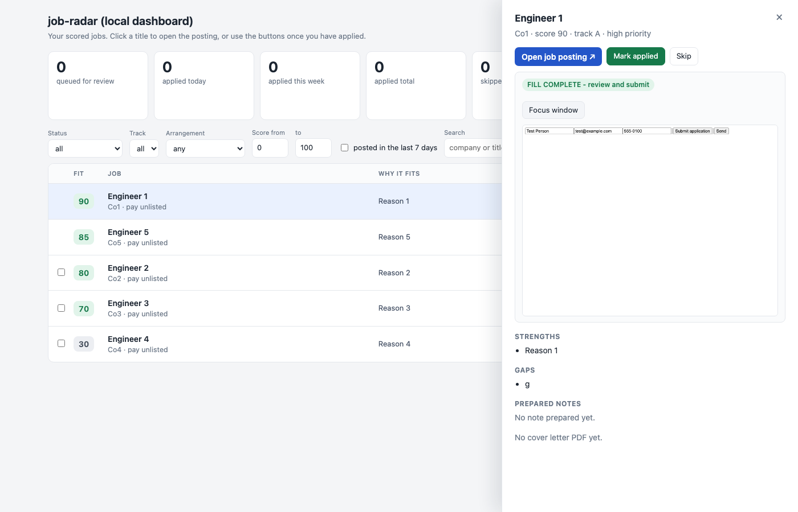

# job-radar

A daily job scanner for entry-level roles, an AI scorer measured by an eval harness, and an apply-assist that fills application forms and then **stops so a human can review and submit**. It is built to be run on your own machine with your own profile. Nothing here applies to jobs automatically.

## Problem

Finding relevant entry-level roles means checking dozens of company career pages every day, reading each posting for seniority, pay, location and work arrangement, and then retyping the same personal details into form after form. Job boards that aggregate postings often forbid scraping, bury the pay range, or rank by recency instead of fit.

job-radar automates the repetitive parts and keeps the decisions with you:

- it reads only public, documented job APIs and feeds you opt in to (no logins, no scraping of sites that forbid it);
- it filters and ranks postings with plain code (title, seniority, location, pay floor, work arrangement, freshness) and uses an LLM only for the fit score;
- it fills application forms in a visible browser window and hands the window over to you. It never clicks Submit.

## How it works



1. **Collect.** Public Greenhouse, Lever and Ashby JSON APIs (plus a handful of other board types and optional feeds) are polled politely: one request per second per host, retries with backoff, an identifying User-Agent, robots.txt respected.
2. **Prefilter (code, no LLM).** Title tracks, seniority words, "3+ years" language, location tiers, a configurable base-pay floor, and work arrangement (remote / hybrid / onsite, office days when stated). Pay and arrangement come from structured API fields first and text parsing second, with unit tests against captured responses.
3. **Score (LLM, once per job).** A strict, schema-validated JSON verdict, cached by source, job id, prompt version, prompt hash and profile hash, so nothing is scored twice. A monthly spend cap in a local ledger refuses calls that would pass it.
4. **Rank and report.** Fit, pay status, arrangement and freshness are combined into a Markdown digest and the local dashboard.
5. **Prepare and hand off.** For jobs you pick, a visible Chromium window opens the real application form, fills it from your `answers.json`, attaches the right resume, drafts a short tailored note and cover letter (facts checked against your profile), re-reads the form to verify, and then lifts its own network block and leaves the page to you.

## Results

> n = 150. All gold labels were produced by an AI proxy (Sonnet) using the author's interview-likelihood rubric and profile. These numbers were measured on **one candidate's private labelled data** and describe how well the scorer matched that one rubric; they are not a general accuracy claim. The human spot-check of the proxy labels is still PENDING.

Prompt **v4**, held-out half, k = 3. Class counts in this half: a=5, m=17, s=53. Strict a-only precision/recall omitted: only 5 'a' labels (< 10 needed).

| Metric | Value [Wilson 95% CI] | n | Reference |
|---|---|---|---|
| Binary label agreement (scorer high/med vs gold a/m) | 94.7% [87.1%-97.9%] | 75 | always-"skip" baseline: 70.7% |
| Exact 3-class agreement (high=a, med=m, low=s) | 88.0% [78.7%-93.6%] | 75 | always-"skip" baseline: 70.7% |
| Precision@10 (positive = a or m) | 100.0% | 10 slots, 22 positives in 75 | random-ranking expectation: 29.3% |
| Recall@15 (positive = a or m) | 63.6% | 22 positives | maximum possible: 68.2% |
| Track accuracy (A vs B), on a/m jobs | 100.0% [85.1%-100.0%] | 22 |  |
| Score stability (mean per-job std dev, 3 trials) | 1.10 | 75 | points on a 0-100 scale |
| pass^3 consistency (all 3 trials same apply decision) | 94.7% [87.1%-97.9%] | 75 |  |
| pass@3 vs gold (any trial matches gold decision) | 96.0% [88.9%-98.6%] | 75 |  |
| pass^3 vs gold (all 3 trials match gold decision) | 90.7% [82.0%-95.4%] | 75 |  |
| apply_priority matches score band | 98.7% | 225 trials |  |

The labelled data behind this table is private and is not part of this repository. What **is** included is a small synthetic set in `eval/sample/` that exercises the same harness end to end (`npm run eval:sample`, which uses a fake scorer). Its numbers are a demonstration that the harness runs, not results.

## Demo and dashboard

**Public demo (sample data only).** `npm run demo:build` writes `docs/index.html` from `src/demo/sample.json`: about 40 invented jobs at invented companies. The builder reads only that file. It then runs a leak check and fails (and deletes the output) if the page contains an email address, a phone number, or a personal string. The page has the same table, filters and counters as the real dashboard, read-only, under a "SAMPLE DATA" banner. If you publish this repository with GitHub Pages (folder `/docs`), this page is the live demo. `npm run demo:shots` regenerates the screenshots from the demo only.




**Local dashboard (your real data, your machine only).** `npm run dashboard` serves http://127.0.0.1:4173 (`DASHBOARD_PORT` changes the port). It shows every scored job with filters (status, track, remote/hybrid, score range, posted in the last 7 days, text), counters (applied total, this week, today, queued, skipped), a per-day applied chart, and a row detail with strengths, gaps, cover letter, prepared note and the apply link. Applied / Skip buttons write through the same code path as `npm run mark`. From a row you can open the form and let the tool fill it; the screenshots below use a mock form.




**Eval results in one line.** On the held-out half (prompt v4, k = 3), binary label agreement is 94.7% [87.1%-97.9%] against an always-skip baseline of 70.7%; precision@10 is 100.0%; recall@15 is 63.6% (maximum possible 68.2%); track accuracy is 100.0% [85.1%-100.0%]. The gold labels come from an AI proxy, not a human, and one candidate's rubric; see Results above. The sample jobs in the demo have invented scores and say nothing about accuracy.

**Review queue and volume.** `npm run prepare -- --top N` (up to 10 per day by default; `--cap N` or `JOB_RADAR_DAILY_CAP` changes it) prepares tabs in the background and hands each one off as soon as it passes verification. Prepared jobs wait in `npm run queue` and are not picked again until you `npm run mark -- <source:id> applied|skip`. If a site rejects the automated window (captcha, bot score), `npm run sheet -- <source:id>` prints every answer, the cover letter text and the file paths so you can apply in your normal browser. Nothing in that path tries to get past a bot check.

## Safety design

- **Never auto-submits.** Three layers: (1) a submit guard that aborts every non-GET request and cancels form `submit` events while the tool works; (2) a lockdown wrapper around the page that refuses to click submit-type controls, press Enter, call `form.submit()` or dispatch events, and after handoff cannot act on the page at all; (3) a human handoff: when a form verifies as complete the tool lifts its guard for that tab and stops. You review and press Submit yourself. A form that is not complete keeps its guard and is finished in your normal browser.
- **Facts only.** Generated notes and cover letters are validated: every number and name must appear in your profile or the posting, otherwise the text is dropped, never invented.
- **Legal and attestation answers** (work authorization, sponsorship, demographic, veteran, disability, criminal history and similar) are filled only if you wrote the exact answer in `answers.json` and it matches a form option exactly; otherwise they are left blank and listed.
- **Local dashboard hardening.** Bound to `127.0.0.1` only (no host option). Reads use a read-only database connection. The only writes are marking applied/skip, **Open and fill** (start a prepare) and adding a link; each is a POST that must carry the dashboard's own `Origin`, a matching `Host` (defeats DNS rebinding), a JSON body and a random per-process token that only the page knows. A launch request can name only job keys that exist in the database: no URL, path or command is ever taken from a request. A Content-Security-Policy forbids external requests.
- **No scraping of LinkedIn, Indeed or Handshake.** Those sites forbid it. Alerts from them arrive as email you forward to a mailbox the tool reads over IMAP (`npm run ingest:email`), or you paste a posting link with `npm run add -- <url>`.
- **robots.txt is respected.** A board whose robots.txt disallows its API is not called.
- **Read-only public APIs, polite rate limits,** identifying User-Agent, no logins, no stored passwords, no account creation, no captcha or login-wall workarounds.
- **Cost control.** LLM spend is recorded in a local ledger with a monthly cap (default $20, reset on the 1st); calls that would pass the cap are refused before they are made.

## Sources

| Kind | Sources | Apply-assist |
|---|---|---|
| ATS boards (public JSON) | Greenhouse, Lever, Ashby | **Fillable**: the tool opens the form, fills it and hands off |
| ATS boards (public JSON) | Workable, Recruitee, BambooHR, Breezy, Personio, Teamtailor, Workday | Scanned and scored; **apply by hand** (the digest and dashboard give you a prepared note and cover letter to paste) |
| ATS board, disabled | SmartRecruiters | Its robots.txt disallows the API, so it is **not called** |
| Feeds | Hacker News "Who is hiring", RemoteOK, We Work Remotely | Apply by hand |
| Feeds needing a free key | USAJobs, Adzuna | Apply by hand; set the keys in `.env` |
| Email alerts and pasted links | Any job-alert email you forward, any link you add | Fillable if the link is a Greenhouse, Lever or Ashby posting, otherwise by hand |

Which company boards are scanned is your choice: `companies.json` (copy `companies.example.json`). Feeds are enabled in `feeds.json` (copy `feeds.example.json`).

## Limitations

- The scorer was measured on **one person's** labelled data with labels from an AI proxy, not a human. The human spot-check is pending. Treat the numbers as evidence the method works, not as a general accuracy figure for your profile.
- Pay and work-arrangement detection are rule based and covered by unit tests and automated cross-checks, not by a human accuracy study. Structured fields beat text, and some postings contradict themselves.
- **Ashby support is unverified against a live submit.** Success detection after your own submit is tested only on a hand-written approximation of an Ashby form, because those forms are client-rendered. Greenhouse and Lever use captured real markup, but no live form is touched by the tests.
- Workday and the other non-fillable boards are apply-by-hand. SmartRecruiters is blocked by its robots policy. USAJobs and Adzuna need API keys.
- Some employers put their application page behind a bot challenge. The tool only detects this (`npm run sites`), skips those jobs when preparing, and never tries to solve or bypass a challenge.
- Scheduling files for macOS launchd are provided but you must install them yourself (`npm run schedule:print` shows the exact commands; it installs nothing).
- Single user, single machine by design. There is no hosted service.

## Run it with your own profile

```
npm install
cp .env.example .env            # add ANTHROPIC_API_KEY (and PRICE_IN_PER_MTOK / PRICE_OUT_PER_MTOK)
npm run init                    # asks a few questions, writes profile.json and job-radar.config.json
cp answers.example.json answers.json      # standing form answers; fill in yourself
cp companies.example.json companies.json  # the company boards to scan; edit freely
cp feeds.example.json feeds.json          # optional feeds (HN, RemoteOK, WWR, USAJobs, Adzuna)
mkdir resumes                   # put your two resumes here (Track A and Track B) and point answers.json at them
npm test                        # no API key needed
npm run scan -- --fetch-only    # store postings, no LLM
npm run scan                    # fetch, filter, score (within the monthly cap), write digest/YYYY-MM-DD.md
npm run dashboard               # http://127.0.0.1:4173
npm run prepare -- --top 5      # fill the 5 best unapplied forms in one window; you review and submit
npm run mark -- ashby:<id> applied
npm run schedule:print          # prints (does not run) the commands for a daily 7:30 launchd job
```

All personal files (`profile.json`, `companies.json`, `job-radar.config.json`, `feeds.json`, `answers.json`, `.env`, `resumes/`, `data/`, `digest/`, `prepared/`, `eval/private/`) are gitignored. Without them the tool falls back to the committed `*.example.json` files, which describe an invented candidate.

Useful commands: `npm run queue` (prepared jobs waiting for review), `npm run answers:todo` (what to add to `answers.json`), `npm run sheet -- <source:id>` (all answers for applying by hand), `npm run sites` (bot-protected apply pages), `npm run reclassify` (re-apply filters offline), `npm run scan -- --digest-only` (rebuild a digest from stored scores, no fetch, no LLM).

### Eval workflow

```
npm run eval:sample             # the harness on the synthetic sample, fake scorer
npm run sample                  # draw and freeze candidates from your own database
npm run proxy                   # AI-proxy labels with safeguards -> gold set
npm run gold:check
npm run eval -- --prompt v4 --split dev
npm run eval:compare            # fails if precision@10 drops more than 5 points vs the baseline
npm run judge -- --prompt v4 && npm run judge:agreement
```

Point the harness at your own labelled data with `EVAL_DIR` (default `eval/private/`, gitignored).

## License

MIT, see [LICENSE](LICENSE).
